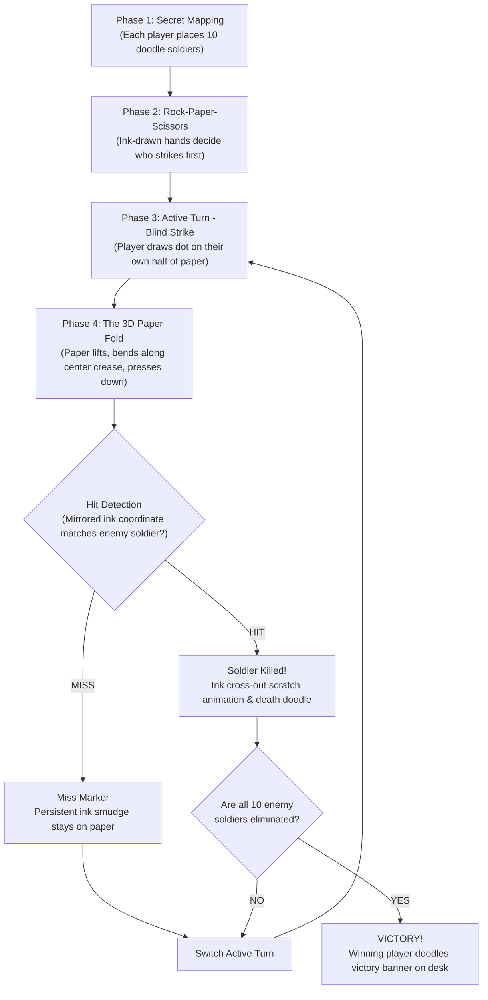

# 🗺️ SOLDIERS (Paper War 1v1) — Architectural Roadmap & Master Plan

## 1. Vision & Core Philosophy

**"Soldiers"** is a tactile, nostalgic 1v1 paper duel game recreating the classic schoolroom game played on ruled notebook paper with red and blue ballpoint pens.

### What Makes This Unique (Anti-"AI Slop")
- **No generic purple gradients, floating glass cards, or sterile corporate SaaS UI.**
- **Real physical immersion:** The entire game lives on a worn wooden student desk under a warm adjustable desk lamp.
- **Physical tactile mechanics:** Real paper that curls, lifts, folds, and creases with dynamic lighting and cast shadows.
- **Authentic ballpoint ink:** Viscous ink that builds up on pen turns, pressure-sensitive strokes, bleed into paper fibers, and drying smudges.
- **Foley & ASMR Soundscape:** Crisp pen scratch on paper, soft paper crinkles, heavy table presses, and wooden desk reverb.

---

## 2. Core Game Loop



---

## 3. Technology Stack Recommendation

| Component | Selected Tech | Rationale |
| :--- | :--- | :--- |
| **Runtime & Bundler** | **Vite + TypeScript** | Sub-second HMR, clean modern ESM, zero bloat, runs 100% on Drive D. |
| **3D Rendering** | **Three.js / React Three Fiber (R3F)** | Industry standard for WebGL/WebGPU 3D, dynamic shadows, post-processing. |
| **Paper Folding Physics** | **GLSL Vertex Shader or Skinned Mesh** | Realistic non-linear page bending without heavy rigid-body engine overhead. |
| **Dynamic Drawing Canvas**| **HTML5 Canvas 2D as Three.js Texture** | Allows 1:1 real-time drawing with mouse, stylus, or touch directly onto the 3D paper. |
| **Multiplayer Networking** | **PeerJS (WebRTC DataChannels)** | Free, decentralized peer-to-peer 1v1 connection. No servers to host or pay for. |
| **3D Asset Creation** | **Blender 5.2.3 (Located in `D:\portable softwares`)** | Desk, pens, props, and rigged paper mesh exported directly to `.glb`. |
| **Audio Engine** | **Howler.js / Web Audio API** | Dynamic multi-channel positional ASMR sound effects with pitch variations. |

---

## 4. The Mathematical Fold & Mirror Projection

The paper is divided into two symmetrical halves across a center crease line ($x_{crease}$):

$$x_{target} = 2 \cdot x_{crease} - x_{strike}$$
$$y_{target} = y_{strike}$$

When Player 1 places a strike dot at coordinates $(x, y)$ on the left half:
1. The 3D paper mesh executes a non-linear curl animation along the $Y$-axis:
   - Angle $\theta(t)$ interpolates from $0^\circ \to 180^\circ$.
   - A curvature factor creates natural paper flex (arch) rather than a rigid hinge.
2. At $\theta = 180^\circ$ (full contact), the contact ink coordinates are computed.
3. If distance $d = \sqrt{(x_{target} - x_{soldier})^2 + (y_{target} - y_{soldier})^2} \le R_{soldier}$:
   - **Result = HIT!**
4. The paper uncurls back to flat state, revealing the new mirrored ink blot and cross-out animation on the victim.

---

## 5. Asset Pipeline & User Creation Guide

The user has **Blender 3D** (`D:\portable softwares\blender-5.2.3-windows-x64`) and local AI tools. Here is the exact asset roadmap:

### A. 3D Models (Blender $\to$ `.glb`)
- [ ] **`desk_scene.glb`**:
  - Wooden desktop slab with realistic wood grain normal map and slight desk scratches.
  - Desk lamp (armature can allow turning light on/off or adjusting angle).
  - Background atmosphere: classroom or dorm room corner out of focus (depth of field).
- [ ] **`ballpoint_pen_blue.glb` & `ballpoint_pen_red.glb`**:
  - Classic transparent hexagonal ballpoint pen with brass ball tip, colored ink cartridge inside.
  - Hover and drawing animations (tilting, tapping, scratching).
- [ ] **`paper_sheet.glb`**:
  - Quad-subdivided plane with crease bones (center bone + 3-4 side leaf bones for smooth curling) OR exported as plain vertex mesh for shader-based deformation.
- [ ] **Desk Props (Optional but high flavor)**:
  - Eraser with rubber crumbs on desk.
  - Metal sharpener, paperclips, coffee/tea mug with ring mark on the wood.

### B. 2D Art & Doodles
- [ ] **Soldier Doodles (10 Red, 10 Blue)**:
  - Hand-drawn stick figure soldiers with rifles, helmets, bazookas, antennas.
  - Transparent PNGs or vector SVGs with rough pen ink borders.
- [ ] **Paper Background Textures**:
  - High-res French ruled / quad graph notebook paper texture (seamless).
  - Paper fiber normal map + roughness map for tactile ballpoint pen response.
- [ ] **Ink FX**:
  - Fresh ink dot stamps, smudges, ink bleed mask.
  - Scratch cross-out animation frames (rapid scribble over killed soldier).
- [ ] **Rock-Paper-Scissors**:
  - 3 hand doodles (Rock fist, Paper flat hand, Scissors peace sign) in sketchy doodle style.

### C. Tactile Audio Foley (ASMR)
- [ ] `pen_draw_dot.mp3`: Short firm ink press sound.
- [ ] `pen_scratch.mp3`: Realistic friction sound of ballpoint pen rolling on paper.
- [ ] `paper_fold.mp3`: Soft crisp paper lift and bend sound.
- [ ] `paper_press.mp3`: Firm hand press slapping paper down to transfer ink.
- [ ] `paper_unfold.mp3`: Paper peeling open with slight adhesive crackle.
- [ ] `hit_kill.mp3`: Aggressive ink cross-out sound followed by a miniature pencil snap or satisfying thud.
- [ ] `victory_jingle.mp3`: Playful school bell chime or pencil tapping rhythm.

---

## 6. Implementation Phases

```
Phase 1: Foundation & Drive D Setup
├── Portable Git & Node.js configured on Drive D
├── Repository synced with GitHub (anaszation/Soldiers)
└── Vite + Three.js + TypeScript project initialized

Phase 2: 3D Environment & Paper Plane
├── Warm wooden desk scene with Three.js shadows & lighting
├── Interactive camera (top-down view for play, slight isometric perspective for atmosphere)
└── Lined notebook paper mesh rendered on desk

Phase 3: Real-Time Ballpoint Pen Engine
├── 2D HTML5 Canvas layered onto 3D Paper Texture
├── Red and Blue pen cursor tracking with pressure simulation
└── Drawing dots, smudges, and soldier placement doodles

Phase 4: The 3D Paper Fold Engine
├── Rigged bone or vertex shader curl physics
├── Folding animation with audio sync
└── Coordinate mirroring math and collision detection ($R \le 18px$)

Phase 5: Gameplay Logic & States
├── State 1: Secret Placement (10 soldiers each, fog of war)
├── State 2: Rock-Paper-Scissors mini-game showdown
├── State 3: Turn-based blind strike loop
└── State 4: Win/Loss detection & victory screen

Phase 6: 1v1 Peer-to-Peer Multiplayer
├── PeerJS / WebRTC room creation & link sharing
├── State synchronization (Placement hashes, strike coordinates, fold triggers)
└── Spectator or local pass-and-play mode

Phase 7: Aesthetic Polish & Tactile ASMR
├── Spatial audio engine (Howler.js)
├── Desk props, lamp switch toggle, ambient dust particles
└── Mobile touch & stylus pressure support
```
